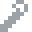
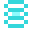
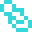

###  Hola, soy Abel

Desarrollador **frontend** que convierte ideas en interfaces vivas: web, animación y contenido visual.
Me gusta **trabajar en equipo** y llevar un producto desde el diseño hasta producción.

###  Lo que hago

- **Frontend**: interfaces rápidas, accesibles y responsive.
- **Motion y animación**: videos y piezas animadas hechas con código (GSAP, HyperFrames, Remotion).
- **Edición gráfica**: portadas, carruseles y piezas para redes sociales.
- **Backend y servidores**: APIs, bases de datos y despliegues con Docker.

###  Stack

###  Proyectos destacados

- **BullFlow**: SaaS de ventas por WhatsApp con IA (Next.js · FastAPI · PostgreSQL · Redis).
- **Motion graphics publicitarios** renderizados con código (HyperFrames · GSAP).

###  Aprendiendo ahora

Nuevos modelos de IA y agentes · generación de imagen, video y voz · automatización de flujos creativos.

###  Busco colaborar en

Productos web con un fuerte componente visual, animación e inteligencia artificial.

<!-- Contacto: agrega aquí tus enlaces cuando quieras, por ejemplo:
[LinkedIn](https://linkedin.com/in/tu-usuario) · [Correo](mailto:tu-correo) · [Portafolio](https://tu-sitio)
-->

